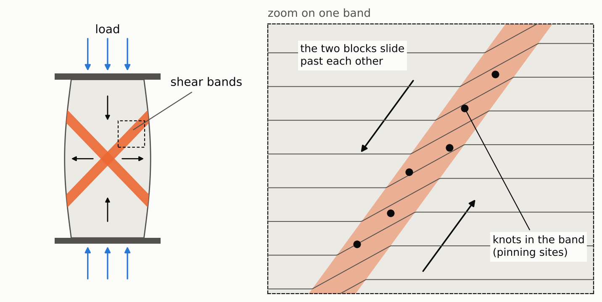
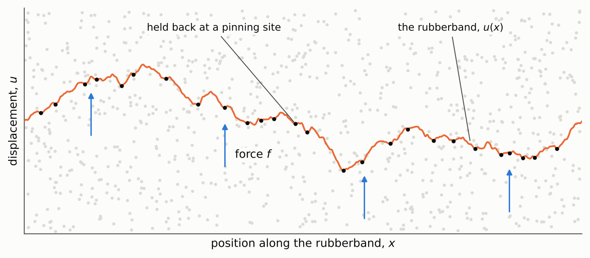
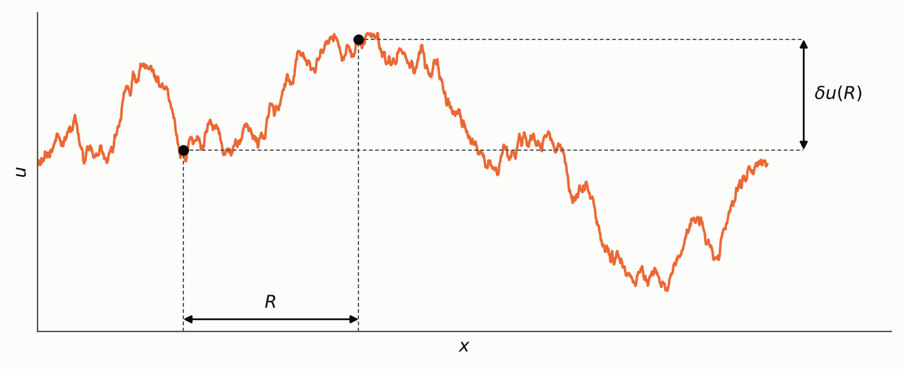
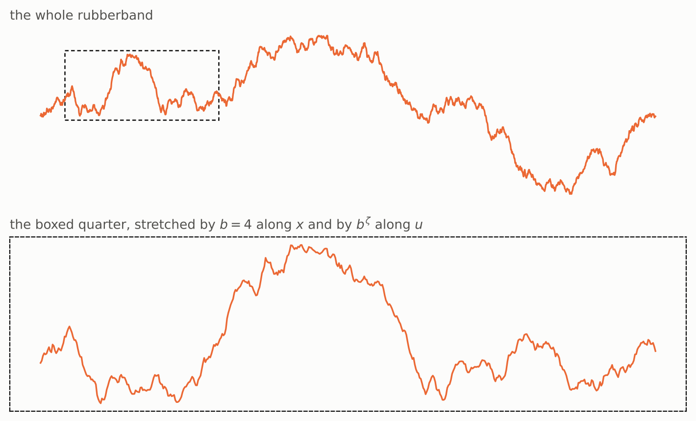
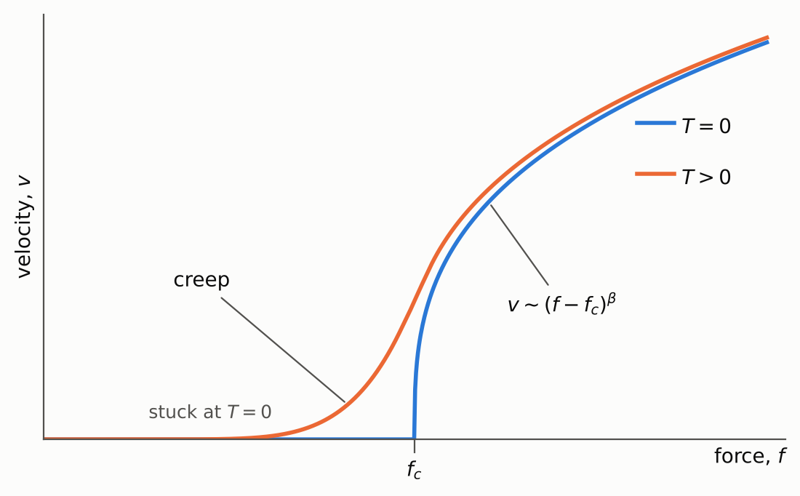
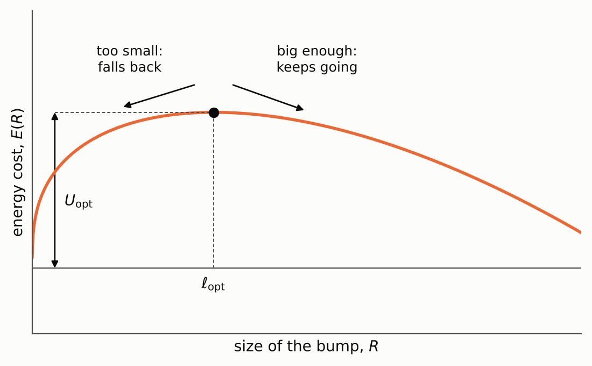
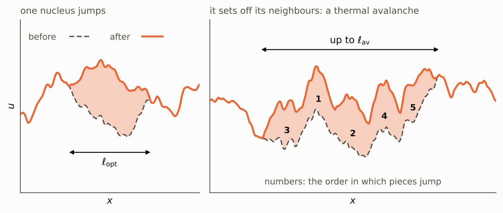
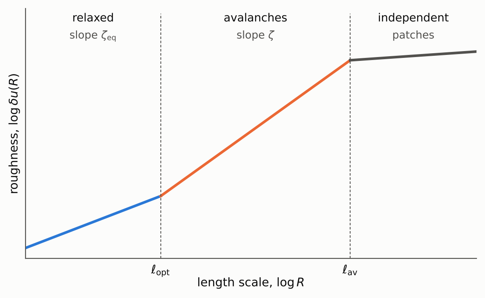

### Background

Have you ever wondered how and why things break? Not just the external reasons, like too big of a load, but the microscopic explanations, like what goes on inside the material as it's breaking.
I wrote my [PhD thesis](https://www.ideals.illinois.edu/items/112772) in part on elastic interfaces in disordered media. This sounds like a very complex problem, but actually it's relatively simple to describe.

Imagine you are pulling a rubberband over a rough surface, and the rubberband gets caught at specific points. As you keep pulling, you can imagine the rubberband will snap off the caught ends to follow the pulling force. That snap is part of a large set of interconnected phenomena known as avalanches. We think of avalanches like a chain reaction process (known as a branching process in math) set off by a single or a set of single events. What comes to mind initially is large piles of snow sliding down a mountain, but earthquakes, neurons, and magnetic realignments are also different manifestations of avalanche behavior [1, 2].

A more motivating example of breaking is that of a pillar that carries a powerful load. Eventually the pillar will develop shear bands (Figure 1), and these bands behave kind of like a rubberband that is being dragged across a rough surface. They want to slip off of each other, but they are prevented by the structural knots (pinning sites) in the material. This problem is well-known [3, 4, 5], but what I studied is how the system behaves at finite temperature.

  Figure 1. Left: a pillar squeezed from above bulges and then gives way along two narrow shear bands that cross in an X, like the clay specimen photographed <a href="https://en.wikipedia.org/wiki/Shear_band">here</a>. Right: zooming in on one band, the blocks on either side slide past each other along it (the thin lines were straight before the slip), held back by knots in the band. (Schematic.)

A good abstracted figure of the situation is shown below:

  Figure 2. The abstract version, seen from far enough away that the rubberband (orange) looks jagged. It is pushed by a force \(f\) and held back where it is caught on pinning sites (black dots; the grey dots are all the other sites). Its shape is described by the displacement \(u(x)\). (Schematic.)

I wanted to finish what I started in my thesis, but actually many people have basically done this and corrected many of the problems I had in my thesis. So when I revisited things, I found a different, smaller problem to address. This is Part 1, which sets up the problem; Part 2 will answer it. Fair warning is that this is a pretty math-heavy post.

### 1. The model

The basic model that captures much of avalanche behavior is written using stochastic calculus:

$$
\eta\,\partial_tu(x,t)=c\nabla^2u+F(x,u)+f+\xi(x,t).
\tag{1}
$$

- $$u$$: displacement of the interface at position $$x$$; $$c$$: elastic constant; $$\eta$$: friction; $$f$$: applied force.
- $$x$$ labels the points of the interface and has $$d$$ components, where $$d$$ is the dimension of the interface itself (more on this just below).
- $$F$$: pinning force, random, with $$\overline{F(x,u)F(x',u')}=\delta^d(x-x')\,\Delta(u-u')$$. $$\Delta$$ is even and decreases for $$u>0$$.
- $$\xi$$: thermal noise, $$\langle\xi\xi\rangle=2\eta T\,\delta^d(x-x')\delta(t-t')$$.

This model is complicated to interpret without some intuition. Basically the force $$f$$ is what drags the rubberband in our situation, and its position as it is dragged along is measured by $$u$$. The rubberband is one-dimensional, and so each piece of it can be displaced by a different amount, so $$u$$ is a function of the linear coordinate along the rubberband, $$u(x)$$.

That is where the $$d$$ in the model comes from. It is the dimension of the thing being dragged, counted from the inside: how many numbers you need to say where you are *on* it. For the rubberband you need one, the distance along it, so $$d=1$$. The shear band in the pillar is a sheet, so there you would need two and $$d=2$$. The displacement $$u$$ is always a single number, the distance moved in the one direction perpendicular to the interface. I'll keep $$d$$ general in the formulas and plug in $$d=1$$ when I want numbers.

One more thing about (1) that is easy to miss: every term in it is a force *per unit volume of the interface*, meaning per unit length for the rubberband and per unit area for a sheet. That goes for the applied force $$f$$ and the pinning force $$F$$ as well. To get the total force on a piece of size $$R$$ you have to multiply by its volume, $$R^d$$. This will matter when we start counting energies.

Back to the terms in (1). The model is overdamped, which means we consider the mass $$\times$$ acceleration of the rubberband as negligible in this case, and instead think of it as being dragged with a natural friction $$\eta$$.

The most confusing terms are $$c\nabla^2u$$ and $$F(x, u)$$. The first is just the elastic force, e.g. the rubberband wants to be straight. The second is the rough surface we described, and it is the most interesting part of the problem. We postulate that it is completely uncorrelated between points on the rubberband, hence the $$\delta^d(x-x')$$. But we allow it to have correlations along points as it is dragged, so $$\Delta(u-u')$$ is not necessarily a Dirac-delta function. Finally the thermal noise $$\xi$$ is the temperature aspect, and it is what I studied the most.

The basic situation is that the rubberband at a fixed force $$f$$ will be stuck at some point when the pinning force $$F(x, u)$$ is stronger. This can happen because we never assumed the force $$F$$ to be bounded. And also in real life, things usually get stuck at some point of stability. The interesting bit is that at a finite temperature $$T$$, a stuck thing can become unstuck, and the process by which it gets unstuck is known as a thermal avalanche.

### 2. Scaling and Avalanches at Zero Temperature

At the microscopic level, the idealized rubberband will be a jagged surface.

  Figure 3. A jagged rubberband. Two points a distance \(R\) apart differ in height by \(\delta u(R)\), which is defined just below. (Computer-generated example, not data.)

It is basically impossible to write down the equation for this surface, partly because it is so rough, and also partly because we don't really care about that. What we care about are the statistics of this surface, in particular the roughness. How far this surface moves in the $$u$$ direction as we move along in the $$x$$ direction, on average.

The way to measure roughness is to pick two points a distance $$R$$ apart along the rubberband and ask how different their displacements are, on average:

$$
\delta u(R)^2\equiv\overline{\big[u(x+R)-u(x)\big]^2}\ \sim\ R^{2\zeta}.
\tag{2}
$$

The overline is an average over the rough surface (or over $$x$$; for a long rubberband it's the same thing). The number $$\zeta$$ is called the roughness exponent. If $$\zeta=0$$ the rubberband is flat, and the bigger $$\zeta$$ is, the more it wanders.

The fact that (2) is a power law is the important part. It means there is no special length in the problem: if you zoom in by a factor $$b$$ along $$x$$ and by a factor $$b^{\zeta}$$ along $$u$$, the picture looks statistically the same (Figure 4).

  Figure 4. Top: a rough line. Bottom: the boxed quarter of it, blown up. You can't tell from the wiggles alone which one is the zoom. (Computer-generated example.)

This only works above a certain length, called the Larkin length $$R_c$$. Unlike most of what follows, this one can be worked out directly from the model, and the argument is a nice warm-up for everything else [6, 20].

Start with a piece of rubberband so short that it hardly moves compared to the size of one bump in the surface. I'll call that size $$r_f$$; it is the distance over which $$\Delta(u)$$ dies off. If a point moves by much less than $$r_f$$, the pinning force on it doesn't change as it moves. So for a short piece we can replace $$F(x,u)$$ by a fixed random force $$F(x)$$ that doesn't care about $$u$$ at all.

Now take a piece of length $$R$$ and ask how far it bends, $$\delta u$$. Two forces compete (both per unit volume of the interface, like everything in (1)):

- the elastic force that wants it straight, about $$c\,\delta u/R^2$$;
- the random force. The piece has volume $$R^d$$. Adding up the independent random forces over it gives a total of about $$\sqrt{\Delta(0)R^d}$$ (random pushes add like a random walk, so the total grows as the square root of the volume). Dividing by the volume, that is $$\sqrt{\Delta(0)/R^d}$$ per unit volume.

Setting them equal,

$$
\delta u(R)\approx\frac{\sqrt{\Delta(0)}}{c}\,R^{(4-d)/2}\qquad\text{(short pieces)}.
\tag{3}
$$

For the rubberband ($$d=1$$) this grows like $$R^{3/2}$$, which is fast. (It also tells you where the number 4 comes from in this field: above four dimensions the exponent is negative, long pieces bend less than short ones, and the rough surface stops mattering.)

So the assumption we started with can't last. Once $$\delta u$$ reaches $$r_f$$, points are moving past whole bumps and the force on them is no longer fixed. That happens at

$$
R_c\approx\Big(\frac{c^2r_f^2}{\Delta(0)}\Big)^{\frac{1}{4-d}} .
\tag{4}
$$

A stiff rubberband on a gentle surface has a long $$R_c$$; a floppy one on a harsh surface has a short one.

Below $$R_c$$ there is only one way for the rubberband to sit. Above $$R_c$$ each point has a choice of bumps to rest against, so there are many ways to sit, and that is where getting stuck, avalanches and everything else interesting comes from. It is also where the roughness changes from (3) to the power law (2), with a different exponent. Matching the two at $$R_c$$:

$$
\delta u(R)\approx r_f\Big(\frac{R}{R_c}\Big)^{\zeta}\qquad\text{for }R>R_c .
\tag{5}
$$

#### Every length has its own force and energy

Here is the idea that makes everything else work. Because of (5), every length scale $$R$$ comes with its own force scale and its own energy scale.

To bend a piece of length $$R$$ by an amount $$\delta u$$ costs an elastic force of about $$c\,\delta u/R^2$$ (the two derivatives in $$c\nabla^2u$$ become two powers of $$1/R$$). When the rubberband is stuck, that elastic force is balanced by the pinning. So the pinning force holding a piece of size $$R$$, per unit volume, is about

$$
F(R)\approx\frac{c\,\delta u(R)}{R^2}=f_c\Big(\frac{R}{R_c}\Big)^{-(2-\zeta)},\qquad f_c\approx\frac{c\,r_f}{R_c^2}.
\tag{6}
$$

Two things to notice. First, small pieces are pinned the hardest. The pinning force at the smallest scale that matters, $$R_c$$, is $$f_c$$, and that turns out to be the force you need to get the whole thing moving. (Using (4), $$f_c$$ is exactly the random force per unit volume on a piece of size $$R_c$$, $$\sqrt{\Delta(0)/R_c^d}$$, as it should be.) Second, bigger pieces are held more weakly, because over a long stretch the random pushes and pulls partly cancel.

For the energy, remember that $$F(R)$$ is a force per unit volume. The total force holding a piece of size $$R$$ is $$F(R)$$ times its volume, $$F(R)\,R^d$$. Energy is force times distance, and the distance that matters is how far the piece has to move to get to its next resting place, which is $$\delta u(R)$$. So

$$
U(R)\approx F(R)\,\delta u(R)\,R^{d}=U_c\Big(\frac{R}{R_c}\Big)^{\theta},\qquad\theta=d-2+2\zeta .
\tag{7}
$$

So the energy goes the other way: bigger pieces sit in deeper valleys. This won't matter until we turn on temperature, and then it matters a lot.

#### The depinning transition

If you pull with a force $$f<f_c$$ at zero temperature, the rubberband moves a bit and gets stuck. If you pull with $$f>f_c$$ it never gets stuck. Right above the threshold the velocity is

$$
v\sim(f-f_c)^{\beta}.
\tag{8}
$$

This is a phase transition, in the same family as a magnet losing its magnetization, with the velocity playing the role of the magnetization [7]. The blue curve in Figure 5 shows it.

  Figure 5. Velocity against force. At zero temperature (blue) nothing moves below the threshold \(f_c\). At finite temperature (orange) there is slow motion below the threshold too; that is the creep of Section 3. (Schematic.)

Near the threshold the motion is not smooth. It happens in avalanches: one piece lets go, drags its neighbors, and so on. Avalanches have a maximum extent, which is the correlation length of the transition (I'll call it $$\ell_{\rm dep}$$ because $$\xi$$ is already taken by the noise):

$$
\ell_{\rm dep}\sim(f-f_c)^{-\nu}.
\tag{9}
$$

There is a quick way to see what $$\nu$$ has to be. The extra force $$f-f_c$$ is enough to free any piece whose pinning force is weaker than it. By (6) those are the pieces bigger than the $$R$$ that solves $$F(R)\approx f-f_c$$. So

$$
\nu=\frac{1}{2-\zeta}.
\tag{10}
$$

(This relation is actually exact, because the elastic term can't be changed by the disorder [8].)

The size of an avalanche, $$S$$, is the area the rubberband sweeps (for a general interface, its volume $$\ell^d$$ times the distance moved). An avalanche of extent $$\ell$$ moves forward by about $$\delta u(\ell)$$, so

$$
S\sim\ell^{\,d+\zeta},\qquad P(S)\sim S^{-\tau}\quad\text{up to}\quad S_{\max}\sim\ell_{\rm dep}^{\,d+\zeta}.
\tag{11}
$$

Most avalanches are tiny and a few are huge, which is the same statistics you see in earthquakes.

For a rubberband ($$d=1$$) the measured numbers are $$\zeta\approx1.25$$, $$\nu\approx1.33$$ and $$\beta\approx0.25$$ [9], and the scaling relation $$\tau=2-2/(d+\zeta)$$ [8] then gives $$\tau\approx1.11$$. A recent review of all of this is [11].

#### One subtlety: there are two roughnesses

The exponent $$\zeta$$ depends on how the rubberband got to where it is.

- If nobody is pulling and it has had forever to find its most comfortable position, you get the *equilibrium* roughness, $$\zeta_{\rm eq}$$. For a rubberband on the most common kind of rough surface, $$\zeta_{\rm eq}=2/3$$ [10].
- If it was dragged there and is just barely stuck, you get the *depinning* roughness, which is the $$\zeta\approx1.25$$ above. A dragged rubberband is rougher than a relaxed one.

So equations (5)–(7) come in two versions, one with $$\zeta_{\rm eq}$$ and one with $$\zeta$$. We are going to need both, and keeping track of which one applies where is most of the game.

Here is everything so far in one place:

| Quantity | Meaning | Scaling |
|---|---|---|
| $$R_c$$ | Larkin length: where the rubberband starts to have a choice | $$(c^2r_f^2/\Delta(0))^{1/(4-d)}$$ |
| $$\delta u(R)$$ | how far a piece of size $$R$$ wanders | $$r_f(R/R_c)^{\zeta}$$ |
| $$F(R)$$ | pinning force on a piece of size $$R$$, per unit volume | $$f_c(R/R_c)^{-(2-\zeta)}$$ |
| $$U(R)$$ | energy scale of a piece of size $$R$$ | $$U_c(R/R_c)^{\theta}$$, $$\theta=d-2+2\zeta$$ |
| $$f_c$$ | threshold force, per unit volume | $$c\,r_f/R_c^2$$ |
| $$\ell_{\rm dep}$$ | largest avalanche above threshold | $$(f-f_c)^{-\nu}$$, $$\nu=1/(2-\zeta)$$ |
| $$S$$ | avalanche size | $$\ell^{\,d+\zeta}$$ |

### 3. Turning on the temperature

Now pull with a small force, $$f\ll f_c$$. At zero temperature nothing happens. At finite temperature the noise $$\xi$$ keeps jiggling the rubberband, and every so often a piece gets jiggled over the bump that was holding it. To get over a barrier of height $$U$$ takes a time of about $$e^{U/T}$$ (I'm measuring temperature in energy units), so the motion is slow, but it isn't zero. This slow motion is called creep. It is the orange tail below $$f_c$$ in Figure 5.

#### Which barrier?

There are barriers at every scale, by (7). Which one sets the speed?

Think about pushing a piece of size $$R$$ forward by $$\delta u(R)$$. It costs an energy $$U(R)$$ to climb out of the valley, and you get back the work done by the applied force. That is the total force on the piece, $$f\,R^d$$ (again, $$f$$ is per unit volume), times the distance moved, $$\delta u(R)$$:

$$
E(R)\approx U_c\Big(\frac{R}{R_c}\Big)^{\theta_{\rm eq}}-f\,r_f\Big(\frac{R}{R_c}\Big)^{\zeta_{\rm eq}}R^{d}.
\tag{12}
$$

I'm using the equilibrium exponents here because a piece that is waiting around to be jiggled has had time to relax.

For small $$R$$ the first term wins and moving costs energy. For large $$R$$ the second term wins and moving is downhill. In between there is a peak (Figure 6), at

$$
\ell_{\rm opt}\sim R_c\Big(\frac{f_c}{f}\Big)^{\frac{1}{2-\zeta_{\rm eq}}},\qquad
U_{\rm opt}\sim U_c\Big(\frac{f_c}{f}\Big)^{\mu},\qquad\mu=\frac{\theta_{\rm eq}}{2-\zeta_{\rm eq}} .
\tag{13}
$$

  Figure 6. The energy cost (12) of pushing a bump of size \(R\) forward. The top of the hill is at \(\ell_{\rm opt}\) and its height is \(U_{\rm opt}\). (Plot of equation (12) in arbitrary units.)

A bump of size $$\ell_{\rm opt}$$ is called a nucleus. Anything smaller falls back; anything that makes it to this size keeps going. Another way to say the same thing: $$\ell_{\rm opt}$$ is the scale whose pinning force (6) equals the force you are applying.

For the rubberband, $$\mu=1/4$$.

#### The creep law

The speed is set by how long you wait for a nucleus:

$$
v\sim\exp\Big[-\frac{U_{\rm opt}}{T}\Big]=\exp\Big[-\frac{U_c}{T}\Big(\frac{f_c}{f}\Big)^{\mu}\Big].
\tag{14}
$$

This is the creep law [12, 13, 14]. The strange thing about it is that the barrier grows without limit as the force goes to zero, so the response to a tiny force is not just small, it is exponentially small. It has been checked in experiments on magnetic domain walls over many decades of velocity [15].

One more quantity falls out of (14) and will be important in Part 2. Ask how much extra force it takes to speed things up by a factor of $$e$$:

$$
\frac{\partial f}{\partial\ln v}=\frac{T\,f}{\mu\,U_{\rm opt}} .
\tag{15}
$$

It is a force, and it is proportional to the temperature.

#### Thermal avalanches

When a nucleus jumps, it pulls on its neighbors. That lowers their barriers, some of them jump too, and you get a cascade that looks a lot like the avalanches of Section 2, except that it was started by heat and not by pulling harder. This is a thermal avalanche (Figure 7).

  Figure 7. Left: one nucleus, of size \(\ell_{\rm opt}\), jumps forward. Right: the jump sets off its neighbors, and the cluster grows up to a size \(\ell_{\rm av}\). (Schematic.)

So there are two lengths in creep, and the picture that has come out of simulations [16, 17] is (Figure 8):

- below $$\ell_{\rm opt}$$ the rubberband is relaxed and has the equilibrium roughness $$\zeta_{\rm eq}$$;
- between $$\ell_{\rm opt}$$ and a larger length $$\ell_{\rm av}$$ it moves in avalanches and has the depinning roughness $$\zeta$$;
- beyond $$\ell_{\rm av}$$ different patches don't know about each other, and the motion averages out to a steady drift.

$$\ell_{\rm av}$$ is the largest size a thermal avalanche reaches.

  Figure 8. Roughness against length scale, on logarithmic axes, so that a power law is a straight line and its slope is the exponent. (Schematic.)

#### The question

How does $$\ell_{\rm av}$$ depend on temperature and force?

There are two answers in the literature. The field-theory calculation that derived the creep law (14) also estimated this length and got $$\ell_{\rm av}\propto T^{-\nu/\beta}$$ [14]. A more recent scaling argument [18] and simulations [19] say $$\ell_{\rm av}\propto T^{-\nu}$$. For the rubberband these are $$T^{-5.4}$$ and $$T^{-1.33}$$, which is not a small disagreement.

Which one is right, and why, is the subject of Part 2. There I'll go through the field-theory calculation and show that, done consistently, it gives $$T^{-\nu}$$ too.

| Quantity | Meaning | Scaling |
|---|---|---|
| $$\ell_{\rm opt}$$ | size of a nucleus | $$R_c(f_c/f)^{1/(2-\zeta_{\rm eq})}$$ |
| $$U_{\rm opt}$$ | barrier of a nucleus | $$U_c(f_c/f)^{\mu}$$ |
| $$v$$ | creep velocity | $$e^{-U_{\rm opt}/T}$$ |
| $$\partial f/\partial\ln v$$ | force needed to speed up by a factor $$e$$ | $$Tf/\mu U_{\rm opt}$$ |
| $$\ell_{\rm av}$$ | largest thermal avalanche | ? |

### References

1. J. P. Sethna, K. A. Dahmen, C. R. Myers, "Crackling noise," *Nature* **410**, 242 (2001). [arXiv:cond-mat/0102091](https://arxiv.org/abs/cond-mat/0102091)
2. J. M. Beggs, D. Plenz, "Neuronal avalanches in neocortical circuits," *J. Neurosci.* **23**, 11167 (2003). [doi:10.1523/JNEUROSCI.23-35-11167.2003](https://doi.org/10.1523/JNEUROSCI.23-35-11167.2003)
3. D. S. Fisher, "Collective transport in random media: from superconductors to earthquakes," *Phys. Rep.* **301**, 113 (1998). [arXiv:cond-mat/9711179](https://arxiv.org/abs/cond-mat/9711179)
4. K. A. Dahmen, Y. Ben-Zion, J. T. Uhl, "Micromechanical model for deformation in solids with universal predictions for stress-strain curves and slip avalanches," *Phys. Rev. Lett.* **102**, 175501 (2009). [doi:10.1103/PhysRevLett.102.175501](https://doi.org/10.1103/PhysRevLett.102.175501)
5. J. Antonaglia, W. J. Wright, X. Gu, R. R. Byer, T. C. Hufnagel, M. LeBlanc, J. T. Uhl, K. A. Dahmen, "Bulk metallic glasses deform via slip avalanches," *Phys. Rev. Lett.* **112**, 155501 (2014). [arXiv:1312.6179](https://arxiv.org/abs/1312.6179)
6. A. I. Larkin, "Effect of inhomogeneities on the structure of the mixed state of superconductors," *Sov. Phys. JETP* **31**, 784 (1970).
7. D. S. Fisher, "Sliding charge-density waves as a dynamic critical phenomenon," *Phys. Rev. B* **31**, 1396 (1985). [doi:10.1103/PhysRevB.31.1396](https://doi.org/10.1103/PhysRevB.31.1396)
8. O. Narayan, D. S. Fisher, "Threshold critical dynamics of driven interfaces in random media," *Phys. Rev. B* **48**, 7030 (1993). [doi:10.1103/PhysRevB.48.7030](https://doi.org/10.1103/PhysRevB.48.7030)
9. E. E. Ferrero, S. Bustingorry, A. B. Kolton, "Nonsteady relaxation and critical exponents at the depinning transition," *Phys. Rev. E* **87**, 032122 (2013). [arXiv:1211.7275](https://arxiv.org/abs/1211.7275)
10. D. A. Huse, C. L. Henley, "Pinning and roughening of domain walls in Ising systems due to random impurities," *Phys. Rev. Lett.* **54**, 2708 (1985). [doi:10.1103/PhysRevLett.54.2708](https://doi.org/10.1103/PhysRevLett.54.2708)
11. K. J. Wiese, "Theory and experiments for disordered elastic manifolds, depinning, avalanches, and sandpiles," *Rep. Prog. Phys.* **85**, 086502 (2022). [arXiv:2102.01215](https://arxiv.org/abs/2102.01215)
12. L. B. Ioffe, V. M. Vinokur, "Dynamics of interfaces and dislocations in disordered media," *J. Phys. C* **20**, 6149 (1987). [doi:10.1088/0022-3719/20/36/016](https://doi.org/10.1088/0022-3719/20/36/016)
13. T. Nattermann, "Scaling approach to pinning: charge density waves and giant flux creep in superconductors," *Phys. Rev. Lett.* **64**, 2454 (1990). [doi:10.1103/PhysRevLett.64.2454](https://doi.org/10.1103/PhysRevLett.64.2454)
14. P. Chauve, T. Giamarchi, P. Le Doussal, "Creep and depinning in disordered media," *Phys. Rev. B* **62**, 6241 (2000). [arXiv:cond-mat/0002299](https://arxiv.org/abs/cond-mat/0002299)
15. S. Lemerle, J. Ferré, C. Chappert, V. Mathet, T. Giamarchi, P. Le Doussal, "Domain wall creep in an Ising ultrathin magnetic film," *Phys. Rev. Lett.* **80**, 849 (1998). [doi:10.1103/PhysRevLett.80.849](https://doi.org/10.1103/PhysRevLett.80.849)
16. A. B. Kolton, A. Rosso, T. Giamarchi, W. Krauth, "Creep dynamics of elastic manifolds via exact transition pathways," *Phys. Rev. B* **79**, 184207 (2009). [arXiv:0902.4557](https://arxiv.org/abs/0902.4557)
17. E. E. Ferrero, L. Foini, T. Giamarchi, A. B. Kolton, A. Rosso, "Spatiotemporal patterns in ultraslow domain wall creep dynamics," *Phys. Rev. Lett.* **118**, 147208 (2017). [arXiv:1604.03726](https://arxiv.org/abs/1604.03726)
18. T. W. J. de Geus, A. Rosso, M. Wyart, "Dynamical heterogeneities of thermal creep in pinned interfaces," *Phys. Rev. E* **111**, L013503 (2025). [arXiv:2401.09830](https://arxiv.org/abs/2401.09830)
19. G. Russo, E. E. Ferrero, A. B. Kolton, A. Rosso, D. Vandembroucq, "Activation and avalanche length scales in the finite-temperature creep of an elastic interface," [arXiv:2604.17600](https://arxiv.org/abs/2604.17600) (2026).
20. A. I. Larkin, Yu. N. Ovchinnikov, "Pinning in type II superconductors," *J. Low Temp. Phys.* **34**, 409 (1979). [doi:10.1007/BF00117160](https://doi.org/10.1007/BF00117160)
