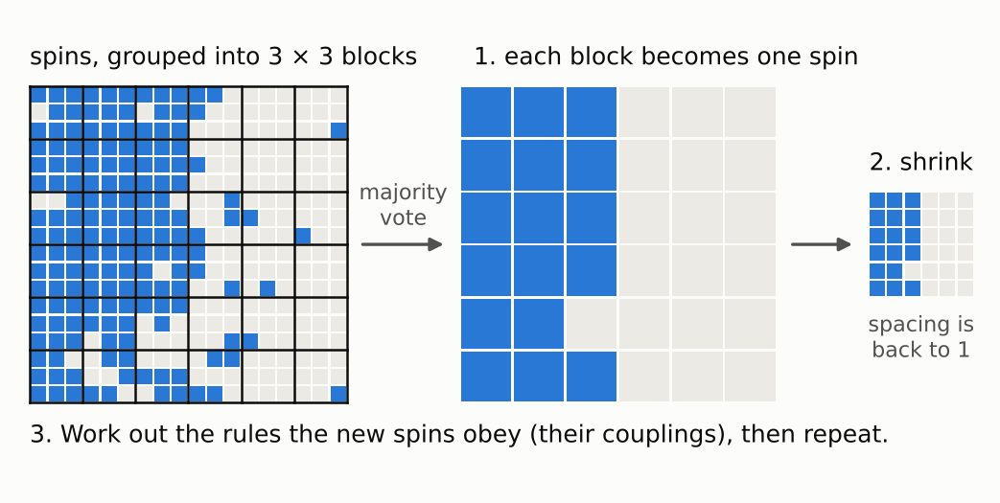
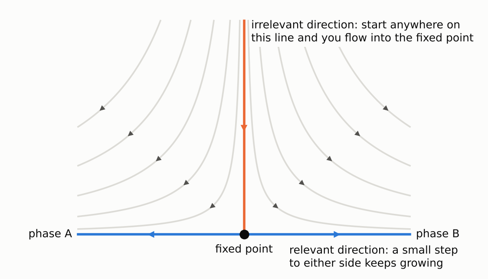
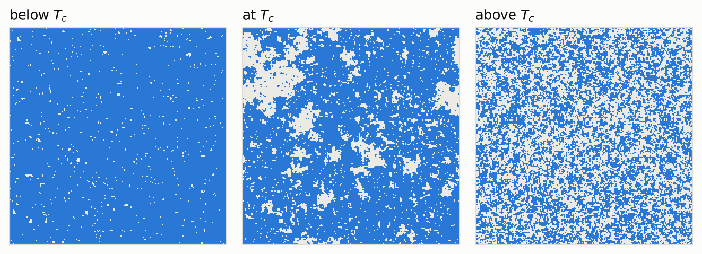
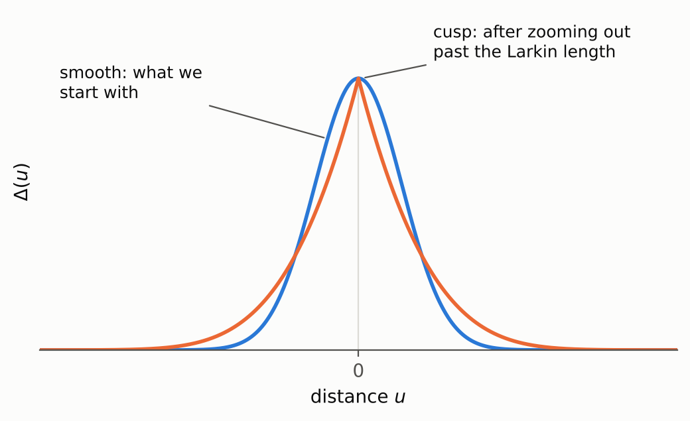
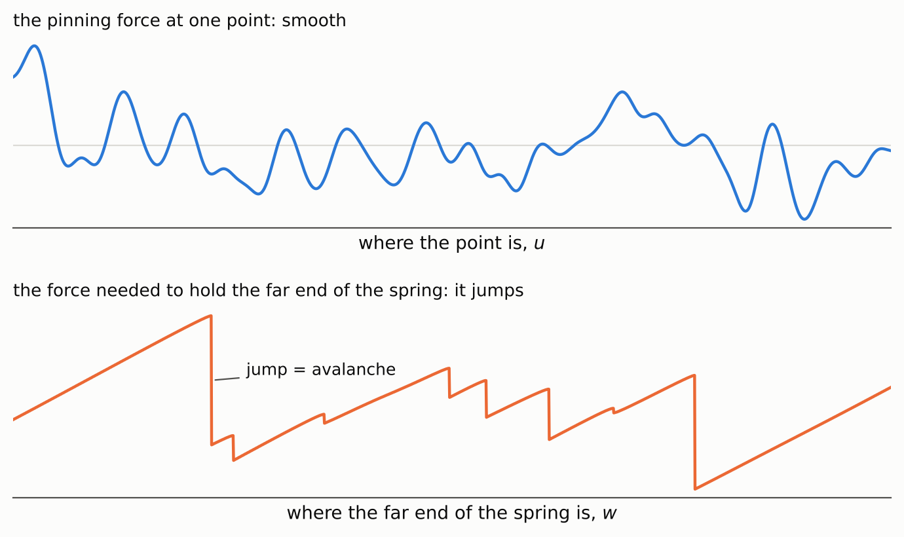

### Renormalization

Before we can tackle the finite temperature case, we have to look at how to even analyze systems like this at zero temperature. I think there are many fascinating approaches to talk about, including simulation, replica symmetry, and cellular automata [1, 2, 3]. Here I want to talk about doing this using renormalization flow. I am going to assume folks are familiar with regular renormalization in this post, see especially reviews by Wilson [4] and Kadanoff [5]. But to cover it slightly, the renormalization flow is a hallmark of physics, one that is particularly important when talking about how microscopic laws can become the physics we see around us. Incidentally it is also useful when dealing with infinite values in QFT, but we won't concern ourselves with that here.

At a high level, renormalization consists of a three step process of progressively zooming out. In step 1, we are going to coarse grain the system that we're studying. The canonical example here is an Ising spin model, in which we coarse grain the spins into blocks of spins (Figure 1) [6]. In step 2, we rescale. Since we did a zoom out, our new system has a larger scale. We will then relabel the scales, such as the position between the centers of the block spins, as the new unit scale. In step 3, we renormalize, which means that we have to find out how the block spins and interactions between them changed, and try to make them look like our original starting point. In the process of doing this, clearly we will have to define new coupling constants, new spins, etc. These will then be the new system, and we can repeat the process.

  Figure 1. One round of zooming out for Ising spins (blue is up, grey is down). Group the spins into 3 × 3 blocks, replace each block by one spin pointing the way most of the block does, and shrink the picture so the spins are as far apart as they were before.

What we want to extract is the flow of our coupling constants, spins, magnetic fields, etc, as we keep zooming out. This flow is important, because it delineates how the system behaves at large, every-day scales. If some constant goes to $$0$$, it probably isn't important at large scales, although as we will see, it sometimes is. If some constant blows up, it probably is important. And some constants don't change quickly as we scale up. In general, we call variables that shrink irrelevant, those that grow relevant, and those that stay roughly the same or grow slowly are known as marginal.

The flow also has other important properties. Maybe the most famous is that the flow can have fixed points. A fixed point of the flow, by definition, is a place where the couplings don't change after a renormalization step. Special fixed points that are unstable in at least one direction are important because that means the flows away from that point push the system away from the fixed point. Therefore, the collective behavior of that fixed point is a transition between two phases (Figure 2). For physicists, these scale invariant points are examples of continuous phase transitions. Unlike boiling, evaporation, or freezing, these phase transitions have fluctuations at all length scales (Figure 3). I wish I could spend more time talking about this, but really it requires a full textbook to understand fully.

  Figure 2. The flow near a fixed point that is unstable in one direction. A system that starts exactly on the orange line ends up at the fixed point. Start a little to either side and the flow carries you off to one of two phases.

  Figure 3. Snapshots of a small simulated Ising magnet below, at and above its critical temperature \(T_c\). Below, one colour has won. Above, the spins are a fine-grained mess. Exactly at \(T_c\) there are patches of every size.

### MSR Action

Here is the model from [Part 1](/2026/11/12/avalanches-and-depinning/) again, with the temperature switched off:

$$
\eta\,\partial_tu(x,t)=c\nabla^2u+F(x,u)+f .
\tag{1}
$$

What we want out of (1) are averages over the rough surface, things like the roughness or the velocity. The trouble is that $$u$$ is whatever solves (1), and the solution depends on the pinning force $$F$$ in a horribly complicated way. We can't solve (1) for one rough surface, never mind average the solution over all of them.

The trick is to not solve the equation at all. It goes back to Martin, Siggia and Rose [7], and the version I'll use is due to Janssen [8] and De Dominicis [9]. We sum over every possible history $$u(x,t)$$ of the rubber band, and we put in a delta function that throws away all of them except the one that solves (1).

#### Warm-up with one variable

Say $$u^*$$ is the solution of some equation $$g(u)=0$$, and we want to know some function of it, $$O(u^*)$$. We can write

$$
O(u^*)=\int du\;\delta\big(g(u)\big)\,\lvert g'(u)\rvert\;O(u).
\tag{2}
$$

The factor $$\lvert g'\rvert$$ is there because $$\delta(g(u))$$ is $$\delta(u-u^*)$$ divided by $$\lvert g'(u^*)\rvert$$. Then we write the delta function as its Fourier transform:

$$
\delta(g)=\int\frac{d\hat u}{2\pi}\;e^{\,i\hat u\,g}.
\tag{3}
$$

So we got rid of the equation, and the price is a second variable $$\hat u$$.

#### One delta function for every point and every time

Equation (1) is really one equation for each point $$x$$ and each time $$t$$. (Chop space and time into small steps if that makes you more comfortable.) So we need one delta function, and one $$\hat u$$, for each $$x$$ and $$t$$. Writing $$\int_{xt}$$ for $$\int d^dx\,dt$$:

$$
O[u_{\rm solution}]=\int\mathcal{D}u\,\mathcal{D}\hat u\;\mathcal{J}\;O[u]\;\exp\Big\{i\int_{xt}\hat u(x,t)\,\big[\eta\,\partial_tu-c\nabla^2u-F(x,u)-f\big]\Big\}.
\tag{4}
$$

Here $$\mathcal{D}u$$ means an integral over the value of $$u$$ at every point and time, and $$\mathcal{J}$$ is the generalization of $$\lvert g'\rvert$$ in (2). Move everything in (1) to the left-hand side and call the result $$E$$, so that (1) reads $$E = 0$$. Then $$\mathcal{J}$$ is the determinant of the matrix of derivatives of $$E$$ with respect to $$u$$. Let's look at that matrix:

$$
\frac{\delta E(x, t)}{\delta u(x', t')} = [\eta \partial_t - c\nabla^2 - F'(x, u)]\delta(x-x')\delta(t-t')
$$

Here $$f$$ drops out as a constant and $$\delta(x-x')\delta(t-t')$$ comes from taking the functional derivative of $$u(x, t)$$ at $$x', t'$$. Clearly this is super complicated to evaluate in general, since it has $$F'$$ in it. But chop time into steps of $$dt$$ and take the Ito convention. This means that the forces in (1) are evaluated at the earlier time, so $$u$$ *only* depends on times before. Then:

$$
E_t = \frac{\eta}{dt}(u(x, t+dt)-u(x, t)) - c\nabla^2u(x, t) - F(x, u(x, t)) - f
$$

Now consider the sequence of all $$E_t$$, which runs from $$E_0$$ to $$E_{T-dt}$$. Practically, if we're solving for $$T$$ time, we don't need an equation at $$T$$ because the $$T - dt$$ step gives us the final output. $$E_t$$ is the equation that determines $$u(x, t+dt)$$. It contains $$u(x, t+dt)$$ only in the first term, and it contains nothing from later times. So the matrix of derivatives is triangular, and the determinant of a triangular matrix is the product of its diagonal entries, which are $$\partial E_t/\partial u(x, t + dt) = \eta/dt$$. This is a constant! It is a huge constant, but it doesn't depend on $$u$$ or on $$F$$, so it drops out of every average and we can safely ignore the Jacobian.

There is one more thing that comes for free. Put $$O=1$$ in (4). The answer is $$1$$, whatever $$F$$ is, because (1) has exactly one solution once you say where the band starts. This sounds trivial, but it is the reason this method works so well for rough surfaces. In equilibrium problems the normalization (the partition function) depends on the rough surface, you have to average its logarithm, and that is what forces people into the replica trick I mentioned above. Here there is nothing to normalize, so we can average (4) over the rough surface directly.

#### Averaging over the rough surface

The pinning force $$F$$ appears in (4) in only one place, the factor $$\exp\{-i\int_{xt}\hat u\,F(x,u)\}$$. And $$F$$ is Gaussian with zero mean. For any Gaussian variable $$\phi$$ with zero mean, $$\overline{e^{-i\phi}}=e^{-\overline{\phi^2}/2}$$. Here $$\phi=\int_{xt}\hat u(x,t)\,F(x,u(x,t))$$, and with the correlator of $$F$$ from Part 1,

$$
\overline{\phi^2}=\int_x\int_{t,t'}\hat u(x,t)\,\hat u(x,t')\;\Delta\big(u(x,t)-u(x,t')\big).
\tag{5}
$$

There is one $$x$$, because the rough surface is uncorrelated between different points of the band. But there are two times.

Last, a change of notation to get rid of the $$i$$'s: rename $$i\hat u\to-\hat u$$. (This means $$\hat u$$ is integrated up and down the imaginary axis. Nothing else changes.) The result is

$$
\overline{O[u]}=\int\mathcal{D}u\,\mathcal{D}\hat u\;O[u]\;e^{-S},
$$

$$
S=\int_{xt}\hat u\,\big(\eta\,\partial_t-c\nabla^2\big)u\;-\;\frac12\int_x\int_{t,t'}\hat u(x,t)\,\hat u(x,t')\;\Delta\big(u(x,t)-u(x,t')\big)\;-\;f\int_{xt}\hat u .
\tag{6}
$$

This is the MSR action. The rough surface is gone. All that is left of it is the function $$\Delta$$.

#### What the action is telling us

Three things are worth pointing out before we calculate anything.

**$$\hat u$$ is how you kick the system.** Add a small extra force $$h(x,t)$$ to (1). In (6) it shows up next to $$f$$, as $$-\int_{xt}\hat u\,h$$. So asking how the band responds to a kick is the same as asking how $$u$$ is correlated with $$\hat u$$:

$$
\frac{\delta\,\overline{u(x,t)}}{\delta h(x',t')}=\overline{u(x,t)\,\hat u(x',t')}\equiv R(x-x',t-t').
\tag{7}
$$

For this reason $$\hat u$$ is called the response field. Without the rough surface we can read $$R$$ straight off (1), which is then a linear equation. For a wave with wavevector $$q$$,

$$
R_q(t)=\frac1\eta\,e^{-cq^2t/\eta}\quad(t>0),\qquad\int_0^\infty R_q(t)\,dt=\frac{1}{cq^2}.
\tag{8}
$$

A kick makes a bulge, and the bulge relaxes. The total displacement you get per unit of force is $$1/cq^2$$. This is the estimate from Part 1 that bending a piece of size $$R$$ by $$\delta u$$ takes a force $$c\,\delta u/R^2$$, turned upside down.

**The rough surface has a memory.** The second term in (6) has two times in it. The rough surface doesn't change with time, so if a piece of the band is at the same place at time $$t$$ and at time $$t'$$, it feels the same force both times. The action remembers everywhere the band has been. Thermal noise has no memory. If we had kept the noise $$\xi$$ and averaged over it the same way, we would have gotten a term $$-\eta T\int_{xt}\hat u^2$$, with a single time. The two terms look alike and behave very differently, and a lot of the difficulty of the finite-temperature problem comes from that.

**The rough surface enters as a whole function.** Not as a number or two. This is what the title of the post is about, and it is the next thing to look at.

### Zooming out at zero temperature

Now we do to (6) what the first section did to the Ising model.

#### Rescaling: why we need a function

I'll start with step 2, the rescaling, because it's easy. Zoom out by a factor $$b$$, so that lengths shrink: $$x=b\,x_{\rm new}$$. To keep the picture looking the same we also have to shrink the displacements, $$u=b^{\zeta}u_{\rm new}$$, which is the roughness exponent $$\zeta$$ of Part 1. Time also rescales with $$t=b^{z}t_{\rm new}$$, in other words big pieces move more slowly than small ones, and $$z$$ is called the dynamic exponent. Note both $$z$$ and $$\zeta$$ are positive. We also have to rescale $$\hat u$$, and I'll choose to do it so that the elastic term in (6) keeps its coefficient $$c$$. (We are allowed to insist on this. As I mentioned in Part 1, the elastic term can't be changed by the disorder [10]. This is a Ward identity, and the symmetry behind it is that tilting the band, $$u\to u+{\rm const}\cdot x$$, doesn't change the statistics of the rough surface.) That means $$\hat u=b^{\,2-\zeta-d-z}\,\hat u_{\rm new}$$. Now count the powers of $$b$$ in each of the other terms of (6):

$$
\eta\to b^{\,2-z}\,\eta,\qquad f\to b^{\,2-\zeta}f,\qquad \Delta(u)\to b^{\,\epsilon-2\zeta}\,\Delta\big(b^{\zeta}u\big),\qquad\epsilon=4-d.
\tag{9}
$$

The middle one says that a small force grows as we zoom out. (Strictly this is the force measured from the threshold $$f_c$$. The threshold itself will show up below.) It becomes of order one when $$b\sim(f-f_c)^{-1/(2-\zeta)}$$, and that is the relation $$\nu=1/(2-\zeta)$$ from Part 1.

The last one is the important one. Before the rough surface has done anything, the band is flat, $$\zeta=0$$, and (9) says $$\Delta\to b^{\epsilon}\Delta$$. Below four dimensions the disorder grows as we zoom out. It's the same 4 as in Larkin's argument in Part 1.

But it is the whole function that grows, every part of it at the same rate. (Exactly at four dimensions the whole function is marginal.) In the usual RG story, the Ising model for example, counting powers tells you that all but one or two of the couplings are irrelevant, and you only have to follow those one or two numbers. Here, write $$\Delta(u)=\Delta_0+\Delta_1u^2+\Delta_2u^4+\dots$$ ($$\Delta$$ is even) and every one of the $$\Delta_n$$ grows as $$b^{\epsilon}$$. There are infinitely many relevant couplings, and no excuse for keeping some and dropping the others. We have to follow the entire function as we zoom out. This is called the functional renormalization group. (It is not the same thing as the exact renormalization group of Wilson, Polchinski and Wetterich, which often goes by that name too.) It was first done for a relaxed interface by Daniel Fisher [11], and for an interface that is being dragged by Nattermann, Stepanow, Tang and Leschhorn [12] and by Narayan and Fisher [10].

#### One step of coarse-graining

Now the hard step. We want to integrate out all the microscopic fluctuations from the action. This means integrating out the short wavelengths (fast part) from the long wavelengths (slow part).

In the language of the action, we split each field into a slow part and a fast part and do the integral over the fast part. We should be mindful here of what we are expanding around. It is, in fact, *two* separate things.

First, we are expanding in powers of the disorder $$\Delta$$, starting from the band with no rough surface at all. Why are we allowed to do this? Well, above 4 dimensions we know that the elastic force overwhelms the disorder at long wavelengths, and just below 4 dimensions the disorder only barely wins. So $$\epsilon = 4 - d$$ is our small quantity.

Second, we are expanding around a particular solution of (1). What solution, you might ask? Well, we are specifically expanding around the $$v \rightarrow 0^+$$ solution, in other words, when the interface is just barely moving above $$f_c$$. This is because at finite velocity the slow part moves appreciably while the fast part is still relaxing, so we can't integrate out the short wavelengths while treating the longer wavelengths as a fixed background. On the other hand, below the threshold there are a huge number of metastable states, and then the question of which state we expand around again becomes a problem. Just above the threshold there is only one steady state, and it only ever moves forward [13].

Now I'll write $$u$$ and $$\hat u$$ for the slow parts, and $$\delta u$$ and $$\delta\hat u$$ for the fast parts. The fast parts are made of waves in a thin shell of wavevectors just below the largest one we still keep, which I'll call $$\Lambda$$. So the shell is $$\Lambda/b<q<\Lambda$$.

**The response function.** An important point of almost all perturbative field theory calculations is that we are dealing with Gaussian integrals in some form or another. Here the Gaussian term is the quadratic part of the action,

$$
\int \frac{d^dq}{(2\pi)^d}\int dt\;\hat{u}(-q, t)\,\big(\eta\,\partial_t + cq^2\big)\,u(q, t),
$$

where I transformed into momentum space. Note the asymmetry between time and space here, one time derivative against two space derivatives, because the motion is overdamped.

A Gaussian integral is completely determined by the inverse of whatever sits in the middle, and the inverse of $$\eta\,\partial_t+cq^2$$ is the response function (8). So when we average over the fast parts, which I'll write with angle brackets, the only pairing that gives anything is one $$\delta u$$ with one $$\delta\hat u$$:

$$
\langle\delta u(q,t)\,\delta\hat u(-q,t')\rangle=R_q(t-t'),\qquad\langle\delta u\,\delta u\rangle=0,\qquad\langle\delta\hat u\,\delta\hat u\rangle=0 .
$$

The two zeros are there because the quadratic part has no $$\hat u^2$$ term. That is the zero temperature talking: the fast parts have no fluctuations of their own. There are two more things to remember about $$R$$. It is causal, so it is zero unless the $$\delta u$$ comes later than the $$\delta\hat u$$, and with the Ito convention it is zero at equal times too. And it is short-lived: a wave in the shell relaxes in a time of about $$\eta/c\Lambda^2$$, which is the shortest time left in the problem.

It helps to see what the fast part is actually doing. Because it relaxes so quickly, it just follows the pinning force. Integrating (8) over time,

$$
\delta u(x)=\int_yG(x-y)\,F(y,u),\qquad G(x)=\int_{\rm shell}\frac{d^dq}{(2\pi)^d}\,\frac{e^{iqx}}{cq^2}.
\tag{10}
$$

($$G$$ is the response function (7) after integrating over time.) I evaluated $$F$$ at $$u$$ and not at $$u+\delta u$$, which assumes the fast part is small. How small? Average the square of (10):

$$
\overline{\delta u^2}=\Delta(0)\,I,\qquad I\equiv\int_yG(y)^2=\int_{\rm shell}\frac{d^dq}{(2\pi)^d}\,\frac{1}{(cq^2)^2}.
\tag{11}
$$

This is Larkin's estimate, equation (3) of Part 1, for a piece of size $$1/\Lambda$$. The number $$I$$ is the only thing we will need to know about the shell.

**The new action.** Call the disorder term in (6) $$V$$, with a shorthand for the fields at the two times, $$\hat u_1=\hat u(x,t_1)$$ and so on:

$$
V=\frac12\int_x\int_{t_1,t_2}\hat u_1\,\hat u_2\;\Delta(u_1-u_2).
$$

The quadratic part of (6) splits cleanly into a slow piece and a fast piece, because they are made of different wavevectors. Only $$V$$ mixes them. So integrating over the fast parts gives

$$
e^{-S_{\rm new}} = e^{-S_{\rm slow}}\,\langle e^{V}\rangle
\quad\Longrightarrow\quad
S_{\rm new} = S_{\rm slow} - \langle V\rangle-\frac12\Big[\langle V^2\rangle-\langle V\rangle^2\Big]-\dots
\tag{12}
$$

where $$S_{\rm slow}$$ is everything in (6) except the disorder term, for the slow parts only. Obviously the average of $$e^V$$ is intractable. But its logarithm is a cumulant expansion, which is what I wrote on the right: the first term is the mean of $$V$$, the second is half its variance, and so on. Subtracting $$\langle V\rangle^2$$ means that at second order we only keep pairings that link the two copies of $$V$$ to each other.

Inside the brackets, every field in $$V$$ is slow plus fast:

$$
V = \frac{1}{2}\int_x\int_{t_1,t_2} (\hat{u}_1+\delta\hat{u}_1)(\hat{u}_2+\delta\hat{u}_2)\Big[\Delta+ \Delta'\,(\delta u_1 - \delta u_2) + \frac{1}{2}\Delta''\,(\delta u_1 - \delta u_2)^2 + \ldots\Big] .
$$

The $$\Delta$$, $$\Delta'$$ and $$\Delta''$$ are evaluated at the slow parts, $$u_1 - u_2$$. If you look, this is literally just the disorder term with the fields split in two, followed by a Taylor expansion of $$\Delta$$ in the fast part.

**First order.** Sort the terms of $$\langle V\rangle$$ by how many slow $$\hat u$$'s are left over once the fast parts are paired up.

- Two left over. This is the only kind of term that could change $$\Delta$$, since the disorder term in (6) has two $$\hat u$$'s. But then both $$\delta\hat u$$'s are gone and we are left with $$\tfrac12\Delta''\,\langle(\delta u_1-\delta u_2)^2\rangle$$, which is zero because two $$\delta u$$'s don't pair. So at first order $$\Delta$$ doesn't change.
- One left over. This is not zero, but with one $$\hat u$$ it looks like the force term in (6) and not like the disorder term. I'll set it aside. It comes back below as the threshold force.
- None left over. This needs $$R(t_1-t_2)\,R(t_2-t_1)$$, and one of the two is always zero because $$R$$ is causal.

So to find the new $$\Delta$$ we have to go to second order.

**Second order.** Now there are two copies of $$V$$, and each one has its own point and its own two times. Call the first copy $$V_a$$, at the point $$x$$ with times $$t_1$$ and $$t_2$$, and the second $$V_b$$, at the point $$y$$ with times $$t_3$$ and $$t_4$$. That is four times to keep track of. There is also the factor of $$1/2$$ in (12). I'm not going to write out the full expression, because it's long. Instead we should reason about which terms can contribute.

We want terms with two slow $$\hat u$$'s left over. Every pairing uses up one $$\delta\hat u$$ and one $$\delta u$$, and the pairings have to link $$V_a$$ to $$V_b$$. That takes two pairings, and there are really only two ways to arrange them. I'll write $$R_{ij}$$ for the response function between the two points, $$R(x-y,\,t_i-t_j)$$, and $$u_{ij}$$ for $$u_i-u_j$$.

What makes the calculation doable is that $$R$$ is short-lived. $$R_{13}$$ is only non-zero when $$t_3$$ is within one fast relaxation time before $$t_1$$, and the slow part has hardly moved in that time. So as far as the slow fields are concerned, $$R_{13}$$ simply sets $$u_3=u_1$$. In the same way the two points $$x$$ and $$y$$ are within $$1/\Lambda$$ of each other, and the slow fields can't tell them apart. Each pairing ties two of the four times together, two pairings leave two free times and one point, and that is the shape of the disorder term we started with. What is left over from the integrals over $$y$$ and the two tied times is the number $$I$$ of (11).

*Case A.* Both $$\delta u$$ from $$V_a$$, both $$\delta\hat{u}$$ from $$V_b$$. From $$V_a$$ we have $$\tfrac12\,\hat{u}_1\hat{u}_2\,\tfrac12\Delta''(u_{12})\,(\delta u_1 - \delta u_2)^2$$, and from $$V_b$$ we have $$\tfrac12\,\Delta(u_{34})\,\delta\hat{u}_3\,\delta\hat{u}_4$$. The pairing is

$$
\langle (\delta u_1 - \delta u_2)^2\,\delta\hat{u}_3\,\delta\hat{u}_4\rangle = 2\,\big[R_{13}R_{14} + R_{23}R_{24} - R_{13}R_{24} - R_{23}R_{14}\big] .
$$

In the first two terms $$t_3$$ and $$t_4$$ are tied to the *same* time, so $$u_3=u_4$$ and $$\Delta(u_{34})$$ becomes $$\Delta(0)$$. In the last two they are tied to different times, one to $$t_1$$ and the other to $$t_2$$, and $$\Delta(u_{34})$$ becomes $$\Delta(u_{12})$$. Each of the four terms gives one factor of $$I$$. Counting the prefactors, there is $$\tfrac12$$ from (12), a $$2$$ because either copy could have played the part of $$V_a$$, and $$\tfrac14\cdot\tfrac12$$ from the two vertices. Altogether,

$$
\frac12\langle V^2\rangle_A=\frac12\int_x\int_{t_1,t_2}\hat u_1\,\hat u_2\;\Delta''(u_{12})\,\big[\Delta(0)-\Delta(u_{12})\big]\,I .
$$

*Case B.* One $$\delta u$$ and one $$\delta\hat u$$ from each. From $$V_a$$ we have $$\hat u_2\,\delta\hat u_1\,\Delta'(u_{12})\,(\delta u_1-\delta u_2)$$. (The $$\tfrac12$$ is gone because either of the two $$\hat u$$'s could have been the fast one, and the two choices give the same thing.) From $$V_b$$ we have $$\hat u_3\,\delta\hat u_4\,\Delta'(u_{34})\,(\delta u_3-\delta u_4)$$. Now $$\delta\hat u_1$$ has to pair with $$\delta u_3$$ or $$\delta u_4$$, and $$\delta\hat u_4$$ with $$\delta u_1$$ or $$\delta u_2$$. That is four possibilities:

- Pairing $$\delta\hat u_1$$ with $$\delta u_3$$ and $$\delta\hat u_4$$ with $$\delta u_2$$ gives $$-R_{31}R_{24}$$. This ties $$t_3$$ to $$t_1$$ and $$t_2$$ to $$t_4$$, so both $$\Delta'$$ become $$\Delta'(u_{32})$$, and the two $$\hat u$$'s left over sit at those same two times.
- Pairing $$\delta\hat u_1$$ with $$\delta u_4$$ and $$\delta\hat u_4$$ with $$\delta u_1$$ gives $$R_{41}R_{14}$$, which is zero because $$R$$ is causal.
- Pairing $$\delta\hat u_1$$ with $$\delta u_3$$ and $$\delta\hat u_4$$ with $$\delta u_1$$ gives $$+R_{31}R_{14}$$. This chains three times together, $$t_4<t_1<t_3$$, so $$u_{34}$$ is squeezed to zero from above and we get $$+\Delta'(0^+)\,\Delta'(u_{32})$$.
- Pairing $$\delta\hat u_1$$ with $$\delta u_4$$ and $$\delta\hat u_4$$ with $$\delta u_2$$ gives $$+R_{41}R_{24}$$. This chains them the other way, $$t_1<t_4<t_2$$, so now it is $$u_{12}$$ that is squeezed to zero, from below, and we get $$+\Delta'(0^-)\,\Delta'(u_{32})$$.

The last two cancel, because $$\Delta'$$ is odd, $$\Delta'(0^-)=-\Delta'(0^+)$$. (For a smooth $$\Delta$$ they are each zero anyway. Remember this, it is about to matter.) Only the first one survives, and with the $$\tfrac12$$ from (12),

$$
\frac12\langle V^2\rangle_B=-\frac12\int_x\int_{t_2,t_3}\hat u_2\,\hat u_3\;\Delta'(u_{32})^2\,I .
$$

**The new correlator.** Both results have the form of the disorder term in (6), two $$\hat u$$'s at one point and two times, multiplying a function of the difference of the two $$u$$'s. So we can read off the change in $$\Delta$$. Writing $$w$$ for that difference,

$$
\Delta_{\rm new}(w)=\Delta(w)-I\,\Big[\Delta'(w)^2+\Delta''(w)\big(\Delta(w)-\Delta(0)\big)\Big]
=\Delta(w)-\frac{I}{2}\,\frac{d^2}{dw^2}\big[\Delta(w)-\Delta(0)\big]^2 .
\tag{13}
$$

Second order also produces terms with three $$\hat u$$'s left over. Those are a new kind of term that wasn't in (6), but counting powers of $$b$$ as in (9) shows that they shrink as we zoom out, so I'll drop them.

There is a way to read (13) without any of the machinery. By (10) the fast part shifts the point where the band samples the rough surface, from $$u$$ to $$u+\delta u$$. So the force at two positions $$u$$ and $$u'$$ is really correlated according to how far apart the *shifted* positions are, and averaging over the shifts smears $$\Delta$$ out: it adds $$\tfrac12\Delta''(w)$$ times the mean square of $$\delta u-\delta u'$$. From (10) and (11) that mean square is $$2I\,[\Delta(0)-\Delta(w)]$$, and this is Case A. Case B is the correction for the fact that the shift is not independent of the force, since the same $$F$$ that we are correlating also made the shift.

#### The flow equation

Make the shell thin, $$b=e^{\delta l}$$ with $$\delta l$$ small. Then $$I$$ is $$\delta l$$ times a constant ($$\Lambda^{-\epsilon}/c^2$$ times a number), and I'll measure $$\Delta$$ in units that make that constant one. Putting the coarse-graining (13) together with the rescaling (9):

$$
\partial_l\Delta(u)=(\epsilon-2\zeta)\,\Delta(u)+\zeta\,u\,\Delta'(u)-\frac12\,\frac{d^2}{du^2}\big[\Delta(u)-\Delta(0)\big]^2 .
\tag{14}
$$

Here $$l$$ is the logarithm of how far we have zoomed out. The first two terms are the rescaling and the last is the coarse-graining. It is an equation for how a *function* changes with scale.

How far can we trust it? It is the first term of an expansion in the strength of the disorder. We'll see below that $$\Delta$$ settles down at a size of order $$\epsilon$$, so strictly the equation is good when $$\epsilon$$ is small, which means just below four dimensions. We are going to plug in $$\epsilon=3$$ anyway and see how wrong it is.

#### The cusp

Start with a smooth $$\Delta$$ and watch the curvature at its top, $$\kappa\equiv-\Delta''(0)$$, which is positive. Take two derivatives of (14), set $$u=0$$, and use $$\Delta'(0)=0$$:

$$
\partial_l\kappa=\epsilon\,\kappa+3\kappa^2 .
\tag{15}
$$

The first term by itself would be plain exponential growth. The second makes $$\kappa$$ blow up at a finite zoom:

$$
\kappa(l)=\frac{\kappa_0\,e^{\epsilon l}}{1-\frac{3\kappa_0}{\epsilon}\,\big(e^{\epsilon l}-1\big)}\;\to\;\infty\qquad\text{when}\qquad e^{\epsilon l_c}=1+\frac{\epsilon}{3\kappa_0}.
\tag{16}
$$

Put the units back. $$\kappa_0$$ is about $$\Delta(0)/r_f^2$$ times the constant $$\Lambda^{-\epsilon}/c^2$$ from above, where $$r_f$$ is the size of one bump. For weak disorder the length $$e^{l_c}/\Lambda$$ at which the blow-up happens is then, up to a number,

$$
\Big(\frac{c^2r_f^2}{\Delta(0)}\Big)^{\frac{1}{4-d}} .
$$

This is the Larkin length $$R_c$$, equation (4) of Part 1. We didn't put it in. The flow found it.

What happens to a function when the curvature at its top becomes infinite? It gets a kink (Figure 4):

$$
\Delta(u)=\Delta(0)-\chi\,\lvert u\rvert+\tfrac12\,\Delta''(0^+)\,u^2+\dots
\tag{17}
$$

Beyond the Larkin length $$\Delta$$ has a cusp at $$u=0$$, with some slope $$\chi$$. Equation (14) carries on working, as long as wherever it says $$u=0$$ we read it as $$u$$ slightly bigger than zero, $$u=0^+$$ [15].

  Figure 4. The correlator \(\Delta(u)\) of the pinning force. Blue: the kind of smooth function we start with. Orange: what it has turned into after zooming out past the Larkin length, with a cusp at \(u=0\). The orange curve is the fixed point (22) below, and the two curves have the same area.

There was no way to avoid this. If $$\Delta$$ stayed smooth, zooming out would give Larkin's roughness, equation (3) of Part 1, at every scale, and we know that is wrong beyond $$R_c$$ [11]. The cusp is how the theory gets out of it.

#### What the cusp means

A kink in a correlation function sounds like a technicality. It is actually most of the physics of Part 1 in one symbol.

From the definition of $$\Delta$$, the difference $$\Delta(0)-\Delta(u)$$ is half the mean square of how much the force on a piece changes when the piece moves by $$u$$. If the force is a smooth function of position, it changes in proportion to $$u$$, and $$\Delta(0)-\Delta(u)$$ goes like $$u^2$$. That is a rounded top. A cusp says the mean square change goes like $$\lvert u\rvert$$. No smooth force does that. A force that *jumps* does. Suppose that as the piece moves forward, the force on it every so often drops suddenly by some amount. Over a short distance $$u$$, the chance of having passed one of these drops is proportional to $$\lvert u\rvert$$, and if you passed one, the force changed by a finite amount. So the mean square change is proportional to $$\lvert u\rvert$$.

So the cusp is telling us that beyond the Larkin length, the force on a piece of the band, as a function of where the piece is, has jumps in it. Figure 5 shows how a perfectly smooth force can turn into one with jumps. It is the smallest version of the problem I can think of: one point of the band, pulled by a spring (which stands in for the rest of the band) across a smooth random force. Move the far end of the spring steadily. The point sits in a resting place while the spring stretches, until the resting place disappears, and then it jumps ahead to the next one and the spring relaxes. Those jumps are avalanches.

  Figure 5. One point of the band, pulled by a spring across a smooth random pinning force (top). Bottom: the force you need on the far end of the spring as you move it steadily along. It builds up while the point is stuck and drops when the point jumps ahead.

The cusp also gives us the threshold force. Go back to the piece of $$\langle V\rangle$$ that we set aside, the one with a single $$\hat u$$ left over. Doing the pairing (the two choices of which $$\hat u$$ is the fast one give the same thing):

$$
\langle V\rangle_{\rm one\ \hat u}=\int_{xt}\hat u(x,t)\int_0^\infty d\tau\;R_{\rm shell}(\tau)\;\Delta'\big(u(x,t)-u(x,t-\tau)\big).
$$

Here $$R_{\rm shell}(\tau)=\int_{\rm shell}\frac{d^dq}{(2\pi)^d}\,R_q(\tau)$$ is the response function (8) added up over the shell. Compare this with the term $$-f\int_{xt}\hat u$$ in (6), remembering the minus sign in front of $$\langle V\rangle$$ in (12). It has the same form, so whatever multiplies $$\hat u$$ is a force. It is the mean pinning force that the fast part passes on to the slow part. If we ignore the delay $$\tau$$, it is $$\Delta'(0)$$ times a constant. With a smooth $$\Delta$$ that is zero: the bumps ahead push back exactly as much as the bumps behind push forward. A smooth $$\Delta$$ can't pin anything. With a cusp, $$\Delta'(0)$$ isn't defined. It is $$-\chi$$ just to the right of zero and $$+\chi$$ just to the left, and we have to ask which one we mean.

The answer is already in the formula: the fast part responds a little late, by (8). The fast part at $$x$$ now was set by the force a time $$\tau$$ ago, and if the band is moving forward at speed $$v$$ it was then a distance $$v\tau$$ behind where it is now. So the mean force is

$$
\overline{F_{\rm new}}=\int_0^\infty d\tau\;R_{\rm shell}(\tau)\;\Delta'(v\tau).
\tag{18}
$$

The argument of $$\Delta'$$ is positive. For a slow band $$v\tau$$ is small, so $$\Delta'(v\tau)\approx-\chi+\Delta''(0^+)\,v\tau$$, and doing the two time integrals with (8) gives

$$
\overline{F_{\rm new}}=-\chi\int_{\rm shell}\frac{d^dq}{(2\pi)^d}\,\frac{1}{cq^2}\;+\;\Delta''(0^+)\,I\;\eta v .
\tag{19}
$$

The first term is a force that pushes backwards however slowly the band moves. Every shell beyond the Larkin length contributes one, and their sum is the threshold force $$f_c$$. (The band only ever moves forward when it is pushed forward [13], which is why $$0^+$$ is the right choice throughout.) The second term is proportional to the velocity, so it is a correction to the friction:

$$
\eta\to\eta\,\big[1-\Delta''(0^+)\,I\big].
\tag{20}
$$

So having many places to rest, moving in avalanches, and having a threshold force are all the same fact, and the fact is the cusp.

#### The fixed point and the exponents

Now look for a $$\Delta$$ that doesn't change as we zoom out, $$\partial_l\Delta=0$$ in (14).

First the roughness. Integrate (14) over $$u$$ from $$0$$ to $$\infty$$. The last term is a total derivative, and it vanishes at both ends (at $$u=0$$ because $$\Delta-\Delta(0)$$ is zero there, at infinity because $$\Delta$$ dies off). The first two terms, after integrating by parts, give

$$
\partial_l\int_0^\infty\Delta\,du=(\epsilon-3\zeta)\int_0^\infty\Delta\,du .
$$

Coarse-graining moves $$\Delta$$ around, but it can't change its area. So the area stays put only if

$$
\zeta=\frac{\epsilon}{3}.
\tag{21}
$$

With that value of $$\zeta$$, equation (14) with $$\partial_l\Delta=0$$ can be integrated twice by hand. The first integration gives $$\tfrac{\epsilon}{3}\,u\,\Delta=(\Delta-\Delta(0))\,\Delta'$$, and the second gives

$$
y-\ln y=1+\frac{\epsilon\,u^2}{6\,\Delta(0)},\qquad y\equiv\frac{\Delta(u)}{\Delta(0)}.
\tag{22}
$$

This is the orange curve in Figure 4. ($$\Delta(0)$$ itself is not fixed by the equation. It just sets the unit of $$u$$.) Expanding (22) near $$u=0$$ gives the cusp (17) with

$$
\chi=\sqrt{\frac{\epsilon\,\Delta(0)}{3}},\qquad\Delta''(0^+)=\frac{2\epsilon}{9}.
\tag{23}
$$

Notice that $$\Delta$$ is of order $$\epsilon$$, which is what I promised when I said how far (14) can be trusted.

Next the friction. Combine the coarse-graining (20) with the rescaling (9): $$\partial_l\ln\eta=2-z-\Delta''(0^+)$$. For the friction to stay put,

$$
z=2-\frac{2\epsilon}{9}.
\tag{24}
$$

Finally the velocity. It is a displacement over a time, so it scales as $$b^{\zeta-z}$$, while the force measured from threshold scales as $$b^{-(2-\zeta)}$$ by (9). So $$v\sim(f-f_c)^{\beta}$$ with $$\beta=\nu\,(z-\zeta)$$.

For the rubber band, $$\epsilon=3$$:

| Exponent | What it is | This calculation | Measured [16] |
|---|---|---|---|
| $$\zeta$$ | roughness | $$1$$ | $$1.25$$ |
| $$\nu=1/(2-\zeta)$$ | largest avalanche, $$\ell_{\rm dep}\sim(f-f_c)^{-\nu}$$ | $$1$$ | $$1.33$$ |
| $$z$$ | how much slower big pieces are | $$4/3$$ | $$1.43$$ |
| $$\beta=\nu(z-\zeta)$$ | velocity, $$v\sim(f-f_c)^{\beta}$$ | $$1/3$$ | $$0.25$$ |

Not great, not terrible. $$\epsilon=3$$ is not a small number, and we kept only the first term of an expansion in it. The next term has been worked out [14, 15]: $$\zeta=\tfrac{\epsilon}{3}(1+0.143\,\epsilon)$$, which is $$1.43$$ for the rubber band. It overshoots in the other direction, and the truth is in between. What I'd take away from the calculation is not the numbers but the structure: there is a fixed function, it has a cusp, and the cusp is the avalanches and the threshold. A review that covers all of this in much more detail is [17].

#### Why not 2/3?

Part 1 said that a rubber band that has had time to relax has a different roughness, $$\zeta_{\rm eq}=2/3$$. Where is that in (14)?

The answer is a little surprising. To this order, (14) is the same equation for a relaxed band and a dragged one [15]. What differs is the function you start from. If the rough surface is made of random bumps of *energy*, each of finite size, then the force is the derivative of something that dies off, and its $$\Delta$$ has zero area. In that case the area argument above says nothing, and (14) has another fixed point, with $$\zeta\approx0.208\,\epsilon$$ [11]. That is $$0.62$$ for the rubber band, close to $$2/3$$.

For a band that is being dragged, the next order of the expansion shows that zero area doesn't survive. Dragging generates area, and you end up at the fixed point (22) whatever kind of rough surface you started with [14, 15]. That is why Part 1 had two roughnesses but only one kind of depinning.

### What's next

Here is this post in one place:

| Quantity | Meaning | Result |
|---|---|---|
| $$S$$ | the MSR action | equation (6) |
| $$\hat u$$ | response field: how you kick the system | $$\overline{u\,\hat u}=R$$ |
| $$\Delta(u)$$ | correlator of the pinning force | flows by (14) |
| $$R_c$$ | Larkin length | where $$-\Delta''(0)$$ blows up, (16) |
| $$\chi=-\Delta'(0^+)$$ | slope of the cusp | sets the threshold force, (19) |
| $$\Delta''(0^+)$$ | curvature next to the cusp | sets the friction, (20) |

Everything here was at zero temperature. Temperature adds the term $$-\eta T\int_{xt}\hat u^2$$ to the action, and in the flow equation (14) it adds a term proportional to $$T\,\Delta''(u)$$. That is a diffusion term, and what diffusion does to a kink is round it off. But the temperature also shrinks as we zoom out, because the barriers grow with scale (equation (7) of Part 1), so the rounding is squeezed into a thinner and thinner layer around $$u=0$$. Since the cusp is the avalanches and the threshold force, how it gets rounded is how the band creeps. That is the next part.

### References

1. A. Rosso, A. K. Hartmann, W. Krauth, "Depinning of elastic manifolds," *Phys. Rev. E* **67**, 021602 (2003). [doi:10.1103/PhysRevE.67.021602](https://doi.org/10.1103/PhysRevE.67.021602)
2. M. Mézard, G. Parisi, "Replica field theory for random manifolds," *J. Phys. I France* **1**, 809 (1991). [doi:10.1051/jp1:1991171](https://doi.org/10.1051/jp1:1991171)
3. H. Leschhorn, "Interface depinning in a disordered medium — numerical results," *Physica A* **195**, 324 (1993). [doi:10.1016/0378-4371(93)90161-V](https://doi.org/10.1016/0378-4371(93)90161-V)
4. K. G. Wilson, J. Kogut, "The renormalization group and the ε expansion," *Phys. Rep.* **12**, 75 (1974). [doi:10.1016/0370-1573(74)90023-4](https://doi.org/10.1016/0370-1573(74)90023-4)
5. L. P. Kadanoff, W. Götze, D. Hamblen, R. Hecht, E. A. S. Lewis, V. V. Palciauskas, M. Rayl, J. Swift, D. Aspnes, J. Kane, "Static phenomena near critical points: theory and experiment," *Rev. Mod. Phys.* **39**, 395 (1967). [doi:10.1103/RevModPhys.39.395](https://doi.org/10.1103/RevModPhys.39.395)
6. L. P. Kadanoff, "Scaling laws for Ising models near $$T_c$$," *Physics* **2**, 263 (1966). [doi:10.1103/PhysicsPhysiqueFizika.2.263](https://doi.org/10.1103/PhysicsPhysiqueFizika.2.263)
7. P. C. Martin, E. D. Siggia, H. A. Rose, "Statistical dynamics of classical systems," *Phys. Rev. A* **8**, 423 (1973). [doi:10.1103/PhysRevA.8.423](https://doi.org/10.1103/PhysRevA.8.423)
8. H.-K. Janssen, "On a Lagrangean for classical field dynamics and renormalization group calculations of dynamical critical properties," *Z. Phys. B* **23**, 377 (1976). [doi:10.1007/BF01316547](https://doi.org/10.1007/BF01316547)
9. C. De Dominicis, "Techniques de renormalisation de la théorie des champs et dynamique des phénomènes critiques," *J. Phys. Colloques* **37**, C1-247 (1976). [doi:10.1051/jphyscol:1976138](https://doi.org/10.1051/jphyscol:1976138)
10. O. Narayan, D. S. Fisher, "Threshold critical dynamics of driven interfaces in random media," *Phys. Rev. B* **48**, 7030 (1993). [doi:10.1103/PhysRevB.48.7030](https://doi.org/10.1103/PhysRevB.48.7030)
11. D. S. Fisher, "Interface fluctuations in disordered systems: $$5-\epsilon$$ expansion and failure of dimensional reduction," *Phys. Rev. Lett.* **56**, 1964 (1986). [doi:10.1103/PhysRevLett.56.1964](https://doi.org/10.1103/PhysRevLett.56.1964)
12. T. Nattermann, S. Stepanow, L.-H. Tang, H. Leschhorn, "Dynamics of interface depinning in a disordered medium," *J. Phys. II France* **2**, 1483 (1992). [doi:10.1051/jp2:1992214](https://doi.org/10.1051/jp2:1992214)
13. A. A. Middleton, "Asymptotic uniqueness of the sliding state for charge-density waves," *Phys. Rev. Lett.* **68**, 670 (1992). [doi:10.1103/PhysRevLett.68.670](https://doi.org/10.1103/PhysRevLett.68.670)
14. P. Chauve, P. Le Doussal, K. J. Wiese, "Renormalization of pinned elastic systems: how does it work beyond one loop?," *Phys. Rev. Lett.* **86**, 1785 (2001). [arXiv:cond-mat/0006056](https://arxiv.org/abs/cond-mat/0006056)
15. P. Le Doussal, K. J. Wiese, P. Chauve, "Two-loop functional renormalization group theory of the depinning transition," *Phys. Rev. B* **66**, 174201 (2002). [arXiv:cond-mat/0205108](https://arxiv.org/abs/cond-mat/0205108)
16. E. E. Ferrero, S. Bustingorry, A. B. Kolton, "Nonsteady relaxation and critical exponents at the depinning transition," *Phys. Rev. E* **87**, 032122 (2013). [arXiv:1211.7275](https://arxiv.org/abs/1211.7275)
17. K. J. Wiese, "Theory and experiments for disordered elastic manifolds, depinning, avalanches, and sandpiles," *Rep. Prog. Phys.* **85**, 086502 (2022). [arXiv:2102.01215](https://arxiv.org/abs/2102.01215)
